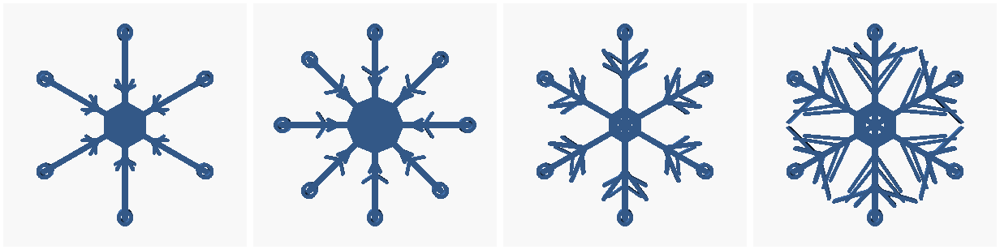

# Infinite Snowflakes

Snowflake decorations generated in OpenSCAD from a seed: every seed gives a
different snowflake with six or eight arms. Each arm ends in a small ring for
hanging, and a printed link hooks through the rings to join snowflakes.

Every seed prints in one piece: each branch starts on its arm's spine and
stops inside its arm's wedge, so none are left floating.

## Use it

Open `src/snowflakes.scad` in [OpenSCAD](https://openscad.org) and set:

- `seed`: any number. Each gives a different snowflake. Seeds 0.00 to 1.00 in
  steps of 0.01 all differ.
- `size`: the span from the top arm's tip to the bottom one's, in mm (55 by
  default). The arms are 4 mm tall.

Render, then export an STL. The console prints the number of arms.

`src/link.scad` makes the connector: a 10 mm bar with an open hook at each end,
meant to hook through the rings at the arm tips. `length` and `width` set its size.

## Printing

- Print flat. Side branches are 0.6 to 1.2 mm wide, so use a 0.4 mm nozzle or
  smaller.
- Nothing reaches past the arm tips, so a snowflake is never wider than
  `size`.
- Hang a snowflake by a thread through one ring, or join several with links.

## Checks

`just test` takes about 6 s on OpenSCAD 2026.10.15. It renders every seed from
0.00 to 1.00 in steps of 0.01 and checks that each is one piece, 55 mm across,
no wider, and 4 mm tall. It also checks that `size` scales the snowflake, and
the link's size.

`just images` renders the picture above. It needs ImageMagick's `montage`.

## Origin and licence

The snowflakes are a rewrite, under MIT, of an idea from Mariano Lambir's
[Infinite Snowflakes](https://www.printables.com/model/91770-infinite-snowflakes)
on Printables: seeded snowflake decorations, hung and joined by links. The
generator and the link are new code, so a seed gives a different snowflake
than it did before. The earlier CC BY 4.0 versions are in this repository's
history. MIT; see [LICENSE](LICENSE).
